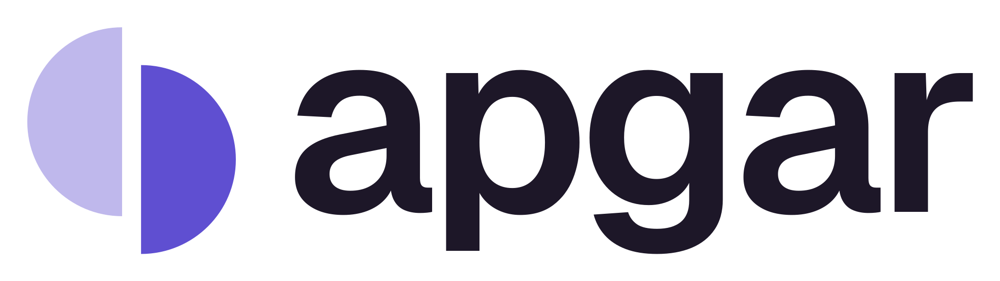
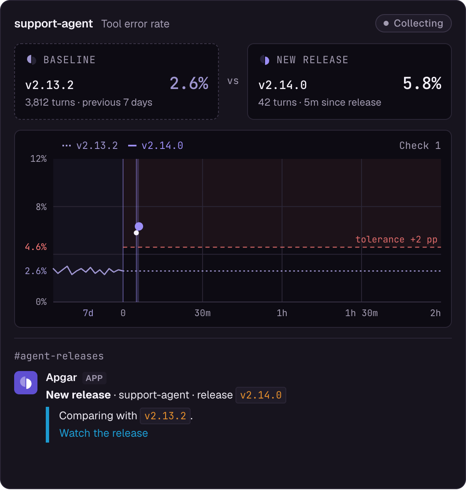
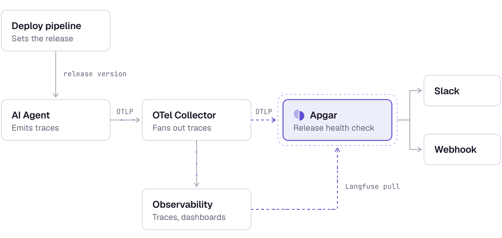

<p align="center">
  <picture>
    <source media="(prefers-color-scheme: dark)" srcset=".github/assets/logo-dark.svg">
    
  </picture>
</p>

<p align="center">Release health for AI agents.</p>

<p align="center">
  <a href="https://useapgar.dev">Website</a> ·
  <a href="https://docs.useapgar.dev/quickstart">Quickstart</a> ·
  <a href="https://docs.useapgar.dev/how-it-works">How it works</a> ·
  <a href="https://docs.useapgar.dev/self-hosting/deploy">Self-hosting</a>
</p>

<p align="center">
  <a href="https://docs.useapgar.dev/how-it-works"></a>
</p>

Agents don't crash when they get worse. Apgar watches the first hours of every release and tells you whether your agent started behaving worse than on the release before it: more tool errors, retries and loops, fewer tool calls, shorter answers, higher cost or latency. It works from the traces you already collect, on all traffic, with no LLM judge, no dataset, and no stored prompt or completion text.

Send traces over OpenTelemetry or from Langfuse, tag each deploy with a release attribute, and get one Slack message or webhook per release. Apgar says which signal moved and where the change is concentrated.

<p align="center">
  <a href="https://docs.useapgar.dev/send-traces/opentelemetry">
    <picture>
      <source media="(prefers-color-scheme: dark)" srcset=".github/assets/where-it-fits-dark.webp">
      
    </picture>
  </a>
</p>

## Install

Apgar runs on one host with Docker Compose: ClickHouse, the API, the worker, and the UI. It needs Docker with Compose v2, `curl`, and `openssl`.

```bash
mkdir apgar && cd apgar
curl -fsSLO https://github.com/oimo-ai/apgar/releases/latest/download/docker-compose.yml
cat > .env <<EOF
APGAR_SECRET_KEY=$(openssl rand -hex 32)
APGAR_ADMIN_TOKEN=$(openssl rand -hex 16)
CLICKHOUSE_PASSWORD=$(openssl rand -hex 16)
APGAR_PUBLIC_URL=http://localhost:8080
EOF
docker compose up -d --wait
```

Open http://localhost:8080 and sign in with the value of `APGAR_ADMIN_TOKEN` in `.env`. While no agent exists, the Agents page offers demo data to explore.

On a server, set `APGAR_PUBLIC_URL` to the address people and exporters use, and terminate TLS in a reverse proxy in front of port 8080. Have the proxy send `X-Forwarded-For`, and add `APGAR_TRUSTED_PROXY_HOPS=2` to `.env` so the login rate limit sees each client's address instead of the proxy's.

On Kubernetes, a Helm chart runs the same services, with ClickHouse in the release or your own. [Kubernetes](https://docs.useapgar.dev/self-hosting/kubernetes) covers the install, ingress, TLS, and external ClickHouse.

## Use with a coding agent

Give Claude Code, Cursor, Codex, or another coding agent the Apgar skill before it sets up an integration:

```bash
npx skills add https://docs.useapgar.dev
```

Then copy and paste this prompt to the agent:

```text
Use the Apgar skill. Look at this codebase and tell me what has to change so that every release of this agent can be compared in Apgar: the traces, the release attribute, and anything the instrumentation leaves out. Do not change code until I agree.
```

[Use with AI agents](https://docs.useapgar.dev/ai-agents) also covers the docs MCP server.

## Upgrade

Read the release notes and back up ClickHouse before every upgrade. [Docker Compose](https://docs.useapgar.dev/self-hosting/deploy#upgrade) and [Kubernetes](https://docs.useapgar.dev/self-hosting/kubernetes#upgrade) list the steps.

## Contributing

See [CONTRIBUTING.md](CONTRIBUTING.md).

## License

Apache-2.0. See [LICENSE](LICENSE).
